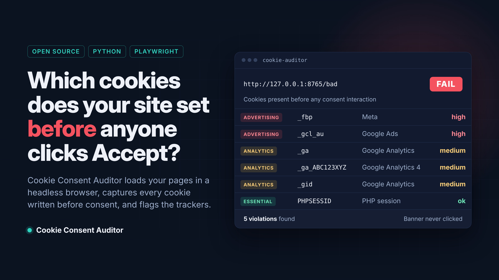

# Cookie Consent Auditor



A command line tool that loads target pages in a headless browser, captures every cookie written before any consent interaction, and classifies each cookie against known tracker signatures. It flags non-essential cookies (analytics, advertising, social) that are set before the visitor has consented.

## How it works

1. **Fresh browser context.** For each URL, Playwright starts a new Chromium context with no cookies and no storage, so the result does not depend on earlier visits.
2. **Load without interaction.** The page loads, waits for the network to go idle, then waits a configurable settle time (default 3 seconds) so tag managers and deferred scripts can run. The tool never clicks, scrolls, or types, so the consent banner is never touched.
3. **Capture.** All cookies in the browser context are read, including third party cookies. Each cookie is recorded with its domain, path, expiry, flags (`Secure`, `HttpOnly`, `SameSite`), and its source: `http` if a `Set-Cookie` response header created it, `javascript` if script created it. Requests to known tracker hosts are recorded as well.
4. **Classify.** Each cookie is matched in this order:
   1. Essential name signatures (sessions, CSRF, load balancers, bot protection, consent management cookies).
   2. Tracker name signatures (Google Analytics, Meta, Hotjar, HubSpot, and others). Generic names such as `fr` or `NID` only match when the cookie domain also belongs to the vendor.
   3. Tracker domain signatures (any cookie set by a known tracker host, for example `doubleclick.net`).
   4. Functional name signatures (language, theme, chat widgets), reported for review.
   5. A heuristic for unrecognised cookies that last longer than one day and hold an identifier like value, reported for review.
5. **Verdict.** Each page receives one verdict.

| Verdict | Meaning |
|---|---|
| `FAIL` | At least one analytics, advertising, or social cookie exists before consent. |
| `REVIEW` | No definite violation, but functional cookies, unrecognised persistent identifiers, or tracker requests need a manual check. |
| `PASS` | Only essential cookies, or no cookies, before consent. |
| `ERROR` | The page could not be loaded. |

Severity per violating cookie: advertising is `high`, analytics and social are `medium`. A third party cookie is raised to `high`.

## Install

Requires Python 3.10 or newer (developed and tested on 3.13).

```bash
cd cookie-consent-auditor
python -m venv .venv
source .venv/bin/activate          # Windows: .venv\Scripts\activate
pip install -r requirements.txt
python -m playwright install chromium
```

## Quick start with the demo site

The project includes a local demo site with three pages, so you can try the tool without scanning real websites.

```bash
# Terminal 1
python -m demo_site.server

# Terminal 2
python -m cookie_auditor http://127.0.0.1:8765/bad http://127.0.0.1:8765/good http://127.0.0.1:8765/mixed
```

| Demo page | Behaviour | Expected verdict |
|---|---|---|
| `/bad` | Sets `_ga`, `_ga_*`, `_gid`, `_fbp`, `_gcl_au` on load, before the banner is used | `FAIL` |
| `/good` | Sets only a session cookie. Tracking cookies are written only after Accept is clicked | `PASS` |
| `/mixed` | Session cookie plus an unrecognised persistent identifier cookie | `REVIEW` |

## Usage

```bash
# One or more URLs (the scheme is optional, https is assumed)
python -m cookie_auditor example.com another-site.ie

# A list of URLs from a file (one per line, # starts a comment)
python -m cookie_auditor --file urls.txt

# Only JSON and HTML reports, saved to ./out
python -m cookie_auditor example.com --format json,html -o out

# Longer settle time for sites that load trackers late, plus screenshots
python -m cookie_auditor example.com --wait 8 --screenshots

# Watch the browser while it scans
python -m cookie_auditor example.com --headed

# Strict mode for CI
python -m cookie_auditor --file urls.txt --strict
```

An installed copy also provides the `cookie-auditor` command (`pip install -e .`).

### Options

| Option | Default | Description |
|---|---|---|
| `urls` | none | URLs or domains to audit |
| `-f, --file` | none | Text file with one URL per line |
| `-o, --out` | `reports` | Output directory |
| `--format` | `json,md,html` | Report formats to write |
| `--wait` | `3` | Seconds to wait after load for scripts to settle |
| `--timeout` | `30` | Navigation timeout in seconds |
| `--headed` | off | Show the browser window |
| `--user-agent` | desktop Chrome | User agent string |
| `--locale` | `en-IE` | Browser locale. Some sites vary consent behaviour by region |
| `--screenshots` | off | Save a screenshot per page under `<out>/screenshots` |
| `--signatures` | none | JSON file with extra signatures |
| `--strict` | off | Treat review items and tracker requests as failures |
| `--ignore-https-errors` | off | Continue past certificate errors |
| `--quiet` | off | Print only the final summary |

### Exit codes

| Code | Meaning |
|---|---|
| `0` | No page failed |
| `1` | At least one page has a `FAIL` verdict |
| `2` | A scan error occurred, or the arguments were invalid |

This makes the tool usable as a gate in CI, for example a scheduled pipeline that audits production pages and fails on any new pre-consent tracker.

## Reading the reports

Reports are written to the output directory with a timestamp in the file name.

- **HTML** is a single self contained file. It shows a summary table and one table per page, sorted by severity.
- **Markdown** has the same content in a form suitable for tickets or a wiki.
- **JSON** holds every field for programmatic use, including the classification reason for each cookie.

Columns in the cookie tables:

| Column | Meaning |
|---|---|
| Verdict | `violation`, `review`, `ok`, or `info` |
| Category | `advertising`, `analytics`, `social`, `functional`, `unknown`, or `essential` |
| Vendor | Matched vendor, if known |
| Party | `first` if the cookie domain shares the page's registrable domain, otherwise `third` |
| Source | `http` (Set-Cookie header) or `javascript` (set by script) |
| Lifetime | Days until expiry, or `session` |
| Reason | The signature or heuristic that produced the classification |

The Source column helps with remediation. A `javascript` cookie usually comes from a tag or script that needs to be gated behind consent. An `http` cookie comes from the server or a third party response.

## Custom signatures

Pass a JSON file with `--signatures` to add rules. Custom rules are checked before the built in rules. Cookie name patterns are regular expressions matched against the full cookie name, case insensitive.

```json
{
  "essential_cookies": [
    { "pattern": "app_state", "vendor": "MyApp" }
  ],
  "tracker_cookies": [
    { "pattern": "acme_uid", "vendor": "Acme", "category": "advertising" }
  ],
  "tracker_domains": [
    { "domain": "tracking.acme.example", "vendor": "Acme", "category": "advertising" }
  ]
}
```

Valid categories are `analytics`, `advertising`, `social`, and `functional`.

## Tests

```bash
python -m pytest
```

The suite has unit tests for the classifier, CLI tests for argument errors and exit codes, and end to end tests that scan the demo site with a real headless Chromium. Scanner tests are skipped if Chromium is not installed.

## Write up

The reasoning behind the tool, how to read the results and its limitations are covered in [docs/blog.md](docs/blog.md).

## Project layout

```
cookie_auditor/
  cli.py          Argument parsing, orchestration, exit codes
  scanner.py      Playwright scan: load page, capture cookies and tracker requests
  classifier.py   Matching logic, severity, page verdict
  signatures.py   Built in cookie and tracker domain signatures
  models.py       Dataclasses for cookies and scan results
  report.py       Console, JSON, Markdown, and HTML output
demo_site/
  server.py       Local site with good, bad, and mixed consent behaviour
tests/            Unit, CLI and end to end tests
docs/             Blog post and images
```

## Limitations

- **Cookies only.** localStorage, sessionStorage, IndexedDB, and fingerprinting are not inspected. Requests to tracker hosts are reported as a warning, but a request alone is not counted as a cookie violation.
- **Signature based.** A tracker that is not in the signature list is reported as `unknown`, and only flagged for review if it is persistent and identifier like. Add signatures for vendors you encounter.
- **Home page and listed URLs only.** The tool does not crawl. List every page type you need to cover, such as checkout and login pages.
- **Region dependent banners.** Some sites show a consent flow only to visitors in certain regions. Use `--locale` and run the tool from a network location that matches your audience.
- **Analytics classification is conservative.** Some regulators treat certain privacy preserving first party analytics as exempt from consent. The tool still reports analytics cookies as violations. Review the `analytics` findings against the rules that apply to you.
- **Bot protection.** Sites behind aggressive bot detection may block headless Chromium. The result for those pages is `ERROR` or an unrepresentative cookie set.
- **Automated findings are indicators.** Confirm results manually before reporting a site as non-compliant.

Only scan sites you own or have permission to test.
